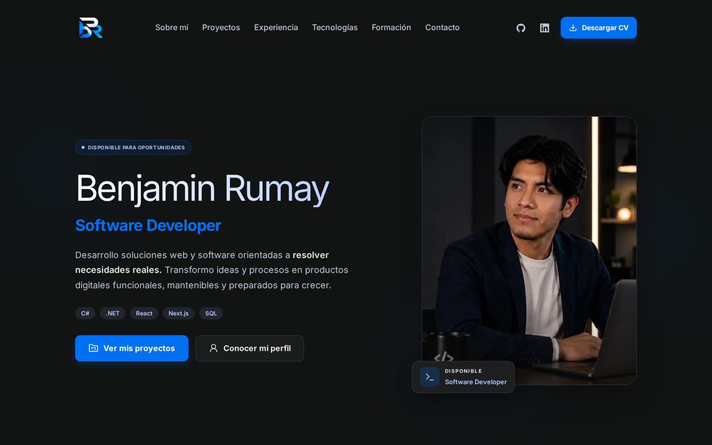

# 🚀 Benjamin Rumay - Portafolio | Software Developer

<p align="center">
  
  
  
  
  
</p>

> _“El software no solo debe resolver problemas, debe sentirse vivo, intuitivo y visualmente impecable.”_

Este proyecto es un **ecosistema digital de alta gama** diseñado para posicionar mi perfil como Software Developer. No es solo una landing page: es una vitrina técnica y visual desarrollada con **Next.js 16**, concebida para fusionar la ingeniería de software robusta con una experiencia de usuario (UI/UX) de nivel premium.

<p align="center">
  
</p>

---

## 📑 Tabla de contenidos

- [🎨 Filosofía de diseño (UI/UX)](#-filosofía-de-diseño-uiux)
- [⚡ Características técnicas destacadas](#-características-técnicas-destacadas)
- [🏗️ Arquitectura del código](#️-arquitectura-del-código)
- [🧠 Decisiones de ingeniería](#-decisiones-de-ingeniería)
- [🚀 Proyectos destacados](#-proyectos-destacados)
- [🛠️ Desarrollo y validación](#️-desarrollo-y-validación-calidad-de-código)
- [🔒 Seguridad y variables de entorno](#-seguridad-y-variables-de-entorno)
- [🌐 Despliegue y mantenimiento](#-despliegue-y-mantenimiento)
- [💎 Conclusión](#-conclusión)

---

## 🎨 Filosofía de diseño (UI/UX)

Cada decisión visual está alineada con la identidad de la marca personal **BR**:

- **Paleta de colores:** fondo oscuro profundo (`#121414`) para reducir la fatiga visual, contrastado con azul eléctrico (`#0070f3`) y azul suave (`#aec6ff`) que dirigen la atención hacia los CTA (_Call to Action_).
- **Tipografía editorial:** la fuente **Inter**, con variables de peso, aporta una apariencia tecnológica y moderna. Los acentos de estilo `code` refuerzan la identidad de desarrollador.
- **Glassmorphism:** tarjetas con efectos de desenfoque (`backdrop-blur`) y bordes sutiles semitransparentes, que aportan profundidad sin sacrificar el rendimiento.
- **Alineación precisa:** sistema de cuadrícula basado en CSS Grid para mantener el contenido equilibrado y una jerarquía visual clara.

---

## ⚡ Características técnicas destacadas

### ✨ Animaciones e interacciones nativas

- **Intersection Observer:** animaciones de aparición (_reveal_, `fade-up` y `staggered`) que se activan eficientemente cuando el usuario hace scroll.
- **Efectos de partículas y typing:** Canvas API optimizado para un fondo dinámico y un efecto de máquina de escribir en el Hero.
- **Microinteracciones:** efectos _hover_ 3D (_Jelly_), bordes iluminados que siguen al cursor y _scroll spy_ en el encabezado.
- **Accesibilidad de movimiento:** control para pausar animaciones y compatibilidad con la media query `prefers-reduced-motion`.

### 📱 Responsive design extremo

El diseño se plantea desde **Mobile First** hasta pantallas de gran formato:

- **iPhone SE:** ajustes precisos de tipografía y espaciado para evitar la saturación visual.
- **iPad Pro de 13 pulgadas:** reorganización de cuadrículas para aprovechar el espacio horizontal.
- **Monitores 2K/4K de 27 pulgadas:** uso de `max-width` controlado y escalado tipográfico con `clamp()` para evitar que el diseño se vea estirado.

### 🎯 Optimización de conversión

- **Integración dinámica con WhatsApp:** el formulario no almacena datos en el servidor. Al enviarlo, empaqueta el nombre, el motivo de contacto y el mensaje, y abre la API de WhatsApp con un texto predefinido y formateado para facilitar una comunicación inmediata.

### 🔍 SEO y rendimiento

- **SEO técnico:** metadata dinámica, Canonical URLs, Open Graph, Twitter Cards, JSON-LD ([Schema.org](https://schema.org/)) y generación de `sitemap` y `robots`.
- **Carga optimizada:** uso de `next/image` para optimización y carga diferida, y `next/font` para evitar desplazamientos de diseño (_layout shift_).

---

## 🏗️ Arquitectura del código

La estructura está modularizada para facilitar la escalabilidad y el mantenimiento:

```text
.
├── .github/                 # Flujos de CI/CD y configuración de GitHub
├── docs/
│   └── capturas/            # Imágenes y recursos para documentación
├── public/
│   └── projects/            # Imágenes estáticas optimizadas de los proyectos
├── src/
│   ├── app/                 # App Router: layouts, páginas y CSS global
│   ├── components/          # Componentes UI y secciones (Hero, About, Projects...)
│   ├── data/                # Datos de proyectos, certificaciones y perfil
│   ├── hooks/               # Hooks personalizados (por ejemplo, scroll lock)
│   ├── lib/                 # Utilidades, validaciones y lógica de animaciones
│   └── types/               # Interfaces y tipos de TypeScript
├── tests/
│   └── unit/                # Pruebas automatizadas con Vitest
└── Archivos de configuración
    ├── next.config.ts
    ├── playwright.config.ts
    └── ...
```

---

## 🧠 Decisiones de ingeniería

1. **Animaciones CSS nativas frente a librerías pesadas:** se eligieron CSS y Canvas API en lugar de Framer Motion o GSAP. Esto ayuda a reducir el tamaño del _bundle_, mejorar el tiempo hasta la interactividad (TTI) y evitar problemas de hidratación en React.
2. **Tipado estricto con TypeScript:** los datos de proyectos (`src/data/projects.ts`) están fuertemente tipados. Una estructura incorrecta se detecta durante la compilación, antes de llegar a producción.
3. **Seguridad y validación:** validación estricta de URLs externas, Content Security Policy (CSP) para mitigar riesgos de inyección XSS y pruebas unitarias que verifican la existencia de los recursos de imagen declarados en los datos.
4. **Gestión de estado sin Redux:** el estado compartido de la interfaz —como el menú móvil o el bloqueo del scroll— se maneja con Context API y hooks personalizados, manteniendo el código organizado y evitando dependencias adicionales para el estado.

---

## 🚀 Proyectos destacados

El portafolio presenta soluciones desarrolladas con distintas tecnologías:

- **Detalles Belis** — _En producción._ Landing page para un emprendimiento de regalos personalizados, con catálogo visual responsive y contacto directo.
- **Atrium Academy** — _En producción._ Plataforma de aprendizaje (_e-learning_) con catálogo de cursos, seguimiento del progreso y panel administrativo.
- **IA Cognitiva** — _Finalizado · Demo en Azure._ Plataforma académica de investigación que integra evaluaciones cognitivas con Machine Learning. Incluye una galería con ocho capturas del sistema real.
- **PlanorIA** — _En desarrollo._ Plataforma educativa con inteligencia artificial, flashcards y quizzes.
- **Kaphiy** — _En desarrollo._ Sistema web y móvil para gestionar pedidos, inventario y ventas.

> Los proyectos en desarrollo se muestran con el estado **“Disponible próximamente”** y no incluyen botón de demo.

---

## 🛠️ Desarrollo y validación (calidad de código)

El proyecto cuenta con un flujo de validación antes de cada despliegue.

### Pruebas unitarias — Vitest + React Testing Library

Validan el renderizado principal, la integridad de las rutas de imágenes, la generación de URLs de WhatsApp y el manejo de _slugs_ inexistentes.

```bash
npm run test
```

### ESLint — calidad de código

Revisa la consistencia del código y el cumplimiento de buenas prácticas.

```bash
npm run lint
```

### Build de producción

Verifica que Next.js y Turbopack compilen el proyecto sin errores.

```bash
npm run build
```

### Playwright — pruebas end-to-end (E2E)

Configurado para ejecutar pruebas en navegador con Chromium.

```bash
npm run test:e2e
```

---

## 🔒 Seguridad y variables de entorno

El proyecto implementa medidas de protección para producción:

- Validación de URLs externas y uso de `noopener` / `noreferrer`.
- Headers de seguridad: `X-Content-Type-Options`, `frame-ancestors` y eliminación de `X-Powered-By`.
- Serialización segura de JSON-LD.
- El archivo `.env.example` sirve como referencia para configurar las variables de entorno. Las variables con prefijo `NEXT_PUBLIC_` son visibles en el cliente; **no deben contener secretos**.

---

## 🌐 Despliegue y mantenimiento

El despliegue está automatizado mediante **Vercel**. Cada `push` a la rama `main` inicia el proceso de build.

**URL principal:** [benjaminrumay-portafolio.vercel.app](https://benjaminrumay-portafolio.vercel.app)

### Mantenimiento

Al actualizar proyectos o certificaciones, comprueba que las imágenes de `public/projects/` coincidan con las rutas declaradas en `src/data/projects.ts`.

Las métricas de rendimiento de Lighthouse pueden variar según el dispositivo, el navegador y la conexión del usuario.

---

## 📑 Conclusión

Este portafolio representa la unión entre **ingeniería de software estructurada** y **diseño de interfaces premium**. Cada parte, desde la lógica de las animaciones hasta la configuración SEO, está pensada para demostrar no solo lo que sé hacer, sino cómo lo hago: con atención al detalle, rendimiento, accesibilidad y pasión por el desarrollo web.

---

<p align="center">
  <i>Construido con dedicación, café y buenas prácticas de código.</i>
  <br />
  <strong>© 2026 Benjamin Rumay</strong>
</p>
