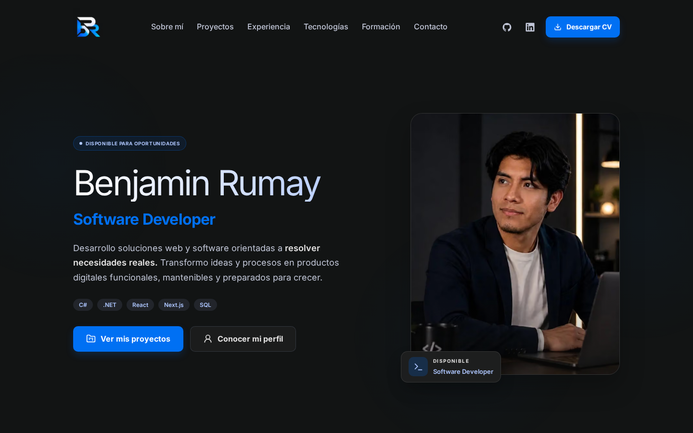

# 🚀 Benjamin Rumay | Software Developer Portfolio

<div align="center">


</div>

> **"Transformo ideas y procesos en soluciones digitales funcionales, mantenibles y preparadas para crecer."**
>
> Portafolio profesional desarrollado para presentar mi perfil como Software Developer, experiencia, conocimientos técnicos y proyectos mediante una experiencia web moderna, accesible y responsive.

<p align="center">
  <a href="https://benjaminrumay-portafolio.vercel.app"><strong>🌐 Ver sitio web</strong></a>
  ·
  <a href="https://github.com/Benyarg/benjamin-rumay-portfolio"><strong>💻 Ver repositorio</strong></a>
</p>

---

## 📖 Descripción general

**Benjamin Rumay Portfolio** es un portafolio personal desarrollado para presentar mi perfil profesional, experiencia, formación académica y una selección de proyectos construidos con diferentes tecnologías.

El proyecto nace de la necesidad de contar con un espacio digital que permita comunicar mis capacidades técnicas, mostrar mi evolución como desarrollador y presentar soluciones de software orientadas a resolver necesidades reales.

La aplicación combina **Next.js 16, React 19, TypeScript y Tailwind CSS 4**, priorizando una arquitectura modular, componentes reutilizables, rendimiento, accesibilidad y una experiencia visual coherente.

El resultado es una plataforma profesional, responsive e interactiva que organiza mi información en diferentes secciones, facilitando la exploración de proyectos, tecnologías, experiencia y canales de contacto.

---

## ✨ Filosofía de diseño (UI/UX)

La interfaz se construyó siguiendo principios de diseño moderno y minimalista, buscando proyectar una identidad profesional mediante una composición visual equilibrada y una navegación intuitiva.

### 🎨 Identidad visual

El diseño utiliza una combinación de tonos oscuros y acentos azules para transmitir profesionalismo, claridad y una identidad tecnológica contemporánea.

- **Tonos oscuros:** establecen una base visual elegante y reducen las distracciones.
- **Acentos azules:** destacan elementos interactivos, indicadores y llamadas a la acción.
- **Superficies translúcidas:** los efectos sutiles de *glassmorphism* aportan profundidad visual sin sobrecargar la interfaz.

### 🔤 Tipografía

Se utiliza **Inter** como tipografía principal, proporcionando legibilidad, consistencia y una estética moderna en títulos, párrafos y elementos de interfaz.

### 🧩 Componentes y composición

La interfaz se organiza mediante componentes reutilizables, tarjetas informativas y secciones independientes que mantienen una jerarquía visual clara.

### 📐 Diseño responsive

Se aplica un enfoque *Mobile First*, con ajustes de distribución, espaciado y tipografía para ofrecer una experiencia consistente en smartphones, tablets, laptops y monitores de alta resolución.

---

## 🚀 Características principales

### 1. Presentación profesional y navegación

- **Perfil profesional:** sección de presentación con información personal, enfoque de trabajo y áreas de interés.
- **Navegación por secciones:** menú interactivo con identificación de la sección activa.
- **Proyectos destacados:** presentación de soluciones desarrolladas mediante tarjetas informativas y detalles de cada proyecto.
- **Experiencia profesional:** organización cronológica de trayectoria, responsabilidades y conocimientos aplicados.
- **Formación académica:** presentación de estudios, rendimiento académico e investigación.
- **Tecnologías y habilidades:** clasificación de herramientas, lenguajes, frameworks y prácticas de ingeniería.

### 2. Animaciones e interacciones (Micro-UI)

- **Scroll Reveal:** animaciones de entrada mediante la API `IntersectionObserver`.
- **Partículas dinámicas:** efectos visuales implementados utilizando la Canvas API.
- **Typing Effect:** animación de escritura para enriquecer la presentación del perfil.
- **Microinteracciones:** transiciones y efectos visuales que acompañan la navegación.
- **Control de animaciones:** opción para pausar los efectos animados y mejorar la experiencia de navegación.

### 3. Diseño responsive y accesibilidad

- **Diseño Mobile First:** adaptación de la interfaz a diferentes resoluciones y dispositivos.
- **Movimiento reducido:** compatibilidad con la preferencia del sistema `prefers-reduced-motion`.
- **Control de movimiento:** mecanismo para pausar animaciones.
- **Consistencia visual:** componentes, contenedores y espaciados organizados para mantener una experiencia uniforme.

### 4. Integración de contacto (CTA)

- **Formulario de contacto:** permite recopilar información como nombre, empresa, correo electrónico, motivo de contacto y mensaje.
- **Generación de mensajes:** construcción de un mensaje estructurado para facilitar la comunicación.
- **Confirmación previa:** el usuario puede revisar el mensaje antes de enviarlo.
- **Privacidad:** el formulario no almacena los datos ingresados en una base de datos propia.

### 5. SEO y optimización de rendimiento

- **Metadatos enriquecidos:** configuración de títulos, descripciones y URL canónica.
- **Open Graph y Twitter Cards:** optimización de vistas previas al compartir enlaces en plataformas sociales.
- **Datos estructurados:** implementación de información mediante JSON-LD.
- **Indexación:** configuración de `robots.txt` y `sitemap.xml`.
- **Optimización de imágenes:** utilización de `next/image` con formatos modernos.
- **Optimización tipográfica:** integración de fuentes mediante `next/font`.

---

## 🛠️ Tecnologías utilizadas

### Stack principal

| Tecnología | Versión | Aplicación |
|---|---:|---|
| Next.js | 16.4.3 | Framework, App Router y renderizado de la aplicación. |
| React | 19.3.0 | Construcción de componentes e interfaces interactivas. |
| TypeScript | 6.0.3 | Tipado estático y definición de estructuras de datos. |
| Tailwind CSS | 4.3.3 | Estilos, utilidades y diseño responsive. |
| Lucide React | 1.49.0 | Iconografía de la interfaz. |
| CSS3 / Canvas API | — | Animaciones, transiciones y efectos visuales. |

### Pruebas y calidad de software

| Tecnología | Versión | Aplicación |
|---|---:|---|
| Vitest | 5.0.3 | Ejecución de pruebas unitarias. |
| React Testing Library | 16.3.3 | Pruebas de componentes e interacción. |
| Playwright | 1.63.0 | Pruebas end-to-end con Chromium. |
| axe-core Playwright | 4.13.0 | Herramientas para auditorías automatizadas de accesibilidad. |
| ESLint | 9.39.5 | Análisis estático y consistencia del código. |
| Prettier | 3.9.9 | Formateo y estandarización del código. |

### Herramientas y despliegue

| Tecnología | Aplicación |
|---|---|
| Git | Control de versiones. |
| GitHub | Alojamiento y gestión del repositorio. |
| Vercel | Despliegue y publicación de la aplicación. |
| PostCSS | Procesamiento de estilos e integración con Tailwind CSS. |

---

## 🏗️ Arquitectura del proyecto

La aplicación sigue una arquitectura modular organizada por responsabilidades, facilitando la separación de la interfaz, la información, las utilidades y la lógica compartida.

```text
benjamin-rumay-portfolio/
├── .github/                    # Configuración y automatización de GitHub
├── docs/
│   └── capturas/                # Capturas para la documentación
├── public/
│   └── projects/                # Imágenes y recursos de proyectos
├── src/
│   ├── app/                     # App Router, páginas y estilos globales
│   ├── components/              # Componentes y secciones de la interfaz
│   ├── data/                    # Información de perfil, proyectos y certificaciones
│   ├── hooks/                   # Hooks personalizados
│   ├── lib/                     # Utilidades y lógica compartida
│   └── types/                   # Interfaces y tipos de TypeScript
├── tests/
│   ├── unit/                    # Pruebas unitarias
│   ├── e2e/                     # Pruebas end-to-end
│   └── setup.tsx                # Configuración de pruebas
├── .env.example                 # Referencia de variables de entorno
├── .nvmrc                       # Versión de Node.js
├── .gitignore                   # Archivos excluidos del repositorio
├── .prettierignore              # Exclusiones de Prettier
├── .prettierrc.json             # Configuración de Prettier
├── eslint.config.mjs            # Configuración de ESLint
├── LICENSE                      # Licencia del proyecto
├── next.config.ts               # Configuración de Next.js
├── package.json                 # Dependencias y scripts
├── package-lock.json            # Bloqueo de dependencias
├── playwright.config.ts         # Configuración de Playwright
├── postcss.config.mjs           # Configuración de PostCSS
├── tsconfig.json                # Configuración de TypeScript
├── vercel.json                  # Configuración de despliegue
└── vitest.config.ts             # Configuración de Vitest
```

---

## 🧠 Decisiones de ingeniería

Durante el desarrollo se priorizaron soluciones ligeras, mantenibles y orientadas a la calidad del software.

- **Arquitectura modular:** separación de componentes, información, hooks y utilidades para facilitar el mantenimiento y la reutilización.
- **Tipado estático:** TypeScript permite mantener estructuras de datos consistentes y reducir errores durante el desarrollo.
- **Gestión de animaciones:** utilización de APIs nativas del navegador como `IntersectionObserver` y Canvas API, evitando dependencias innecesarias para determinados efectos visuales.
- **Optimización de recursos:** uso de las funcionalidades de Next.js para la gestión de imágenes, tipografías y renderizado.
- **Accesibilidad:** consideración de preferencias de movimiento reducido y mecanismos para controlar las animaciones.
- **Calidad de código:** incorporación de ESLint, Prettier y TypeScript para mantener consistencia y detectar problemas durante el desarrollo.
- **Validación automatizada:** utilización de Vitest, React Testing Library y Playwright para verificar componentes y flujos de navegación.

---

## 🚀 Proyectos destacados

El portafolio presenta una selección de proyectos desarrollados en diferentes áreas del software, incluyendo plataformas educativas, aplicaciones web y soluciones comerciales.

| Proyecto | Descripción | Estado |
|---|---|---|
| **Detalles Belis** | Landing page para un emprendimiento de regalos personalizados, con catálogo visual y contacto directo. | En producción |
| **Atrium Academy** | Plataforma e-learning con catálogo de cursos, seguimiento del progreso y panel administrativo. | En producción |
| **IA Cognitiva** | Plataforma académica que integra evaluaciones cognitivas y Machine Learning. | Finalizado · Demo en Azure |
| **PlanorIA** | Plataforma educativa con inteligencia artificial, flashcards y cuestionarios. | En desarrollo |
| **Kaphiy** | Sistema web y móvil para la gestión de pedidos, inventario y ventas. | En desarrollo |

Los proyectos en desarrollo se presentan como próximos trabajos, sin enlaces de demostración hasta que se encuentren disponibles.

---

## 🖥️ Vista previa

El portafolio organiza la información profesional en diferentes secciones para facilitar el recorrido del usuario.

La experiencia permite explorar:

- Perfil y presentación profesional.
- Proyectos destacados y sus detalles.
- Experiencia profesional.
- Tecnologías y habilidades.
- Formación académica y certificaciones.
- Formulario de contacto.

**Captura de escritorio:**



---

## ⚙️ Instalación y ejecución

### Requisitos previos

- Node.js 24.x (mínimo 24.15.0, conforme a `package.json`).
- npm.
- Git.

### 1. Clonar el repositorio

```bash
git clone https://github.com/Benyarg/benjamin-rumay-portfolio.git
```

### 2. Acceder al directorio

```bash
cd benjamin-rumay-portfolio
```

### 3. Instalar dependencias

Se utiliza `npm ci` para instalar las dependencias definidas en `package-lock.json`.

```bash
npm ci
```

### 4. Configurar variables de entorno

El proyecto incluye un archivo `.env.example` con la variable opcional `SITE_URL`, utilizada para establecer el dominio canónico en los metadatos, archivos de rastreo y mapa del sitio.

Puedes crear tu archivo local:

```bash
cp .env.example .env.local
```

Configuración de referencia:

```env
SITE_URL=https://benjaminrumay-portafolio.vercel.app
```

Esta variable no contiene credenciales ni información secreta.

### 5. Iniciar el servidor de desarrollo

```bash
npm run dev
```

Abre la siguiente dirección en tu navegador:

[http://localhost:3000](http://localhost:3000)

### 6. Generar versión de producción

```bash
npm run build
```

### 7. Ejecutar la versión de producción localmente

```bash
npm run start
```

---

## 🧪 Pruebas y calidad de software

El proyecto incorpora herramientas de validación automatizada para comprobar el comportamiento de los componentes, la consistencia del código y la compilación de producción.

| Proceso | Comando | Propósito |
|---|---|---|
| Pruebas unitarias | `npm run test` | Verificar componentes, utilidades y comportamientos principales. |
| Modo de pruebas continuo | `npm run test:watch` | Ejecutar pruebas durante el desarrollo. |
| Pruebas E2E | `npm run test:e2e` | Validar flujos de navegación con Playwright y Chromium. |
| Análisis estático | `npm run lint` | Detectar problemas y mantener convenciones de código. |
| Verificación de tipos | `npm run typecheck` | Comprobar la consistencia de los tipos de TypeScript. |
| Formateo | `npm run format:check` | Comprobar el formato del código mediante Prettier. |
| Build | `npm run build` | Verificar la compilación de producción. |
| Validación integral | `npm run check` | Ejecutar formato, lint, tipado, pruebas unitarias y build. |

### Preparación de Playwright

Para ejecutar las pruebas E2E por primera vez, instala Chromium:

```bash
npx playwright install chromium
```

Después, ejecuta:

```bash
npm run test:e2e
```

La validación integral `npm run check` no incluye las pruebas E2E; estas se ejecutan por separado.

---

## 🔒 Seguridad y SEO

### Seguridad

La aplicación incorpora configuraciones orientadas a reducir riesgos comunes y controlar el comportamiento de los recursos del navegador:

- **Content Security Policy (CSP):** definición de políticas para controlar los recursos y contenidos permitidos.
- **X-Content-Type-Options:** configuración del encabezado `nosniff`.
- **Referrer-Policy:** control de la información enviada en el encabezado Referer.
- **Permissions-Policy:** restricciones de acceso a funcionalidades como cámara, micrófono, geolocalización y pagos.
- **X-Frame-Options:** configuración `DENY` para restringir la inclusión del sitio en frames.
- **Strict-Transport-Security:** configuración HSTS en producción.
- **Exposición de tecnología:** desactivación del encabezado `X-Powered-By`.
- **Variables de entorno:** separación de la configuración local y los archivos públicos.

### SEO técnico

- Metadatos descriptivos y URL canónica.
- Open Graph y Twitter Cards.
- Datos estructurados mediante JSON-LD.
- Archivos `robots.txt` y `sitemap.xml`.
- Configuración de imágenes optimizadas mediante `next/image`.
- Gestión tipográfica mediante `next/font`.

> Las variables `NEXT_PUBLIC_*` de Next.js se exponen al navegador y no deben utilizarse para almacenar credenciales ni claves privadas.

---

## 🌐 Despliegue

El portafolio está desplegado en **Vercel**, utilizando la integración con Next.js.

<https://benjaminrumay-portafolio.vercel.app>

La configuración de despliegue se encuentra en `vercel.json` y establece:

- **Framework:** Next.js.
- **Instalación:** `npm ci`.
- **Compilación:** `npm run build`.

Para mantener actualizada la información de proyectos y certificaciones, revisa los datos definidos en `src/data/` y verifica que las rutas de las imágenes correspondan con los recursos almacenados en `public/projects/`.

---

## 🏆 Resultados del proyecto

El portafolio representa una herramienta de presentación profesional que reúne mi trayectoria, conocimientos y trabajos desarrollados en un único espacio digital.

Su desarrollo permitió consolidar una solución que combina:

- **Identidad profesional:** presentación organizada del perfil y enfoque de trabajo.
- **Exhibición de proyectos:** documentación y visualización de soluciones desarrolladas con diferentes tecnologías.
- **Experiencia de usuario:** navegación intuitiva, interfaz responsive y microinteracciones.
- **Calidad de software:** arquitectura modular, tipado estático y herramientas de pruebas automatizadas.
- **Presencia digital:** plataforma publicada en Vercel, con configuración SEO y optimización de recursos.

El resultado es un portafolio diseñado para comunicar capacidades técnicas, mostrar experiencia aplicada y facilitar nuevas oportunidades profesionales y colaboraciones.

---

## 👨‍💻 Autor

**Benjamin Rumay** · Software Developer

Diseño y desarrollo web enfocado en la creación de experiencias digitales modernas, funcionales y orientadas a las necesidades de cada negocio.

[](https://github.com/Benyarg)

---

## 📄 Licencia

Este proyecto se distribuye bajo la licencia **MIT**.

Consulta el archivo [LICENSE](./LICENSE) para conocer los términos de uso, modificación y distribución.
